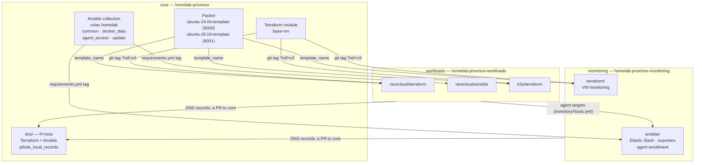
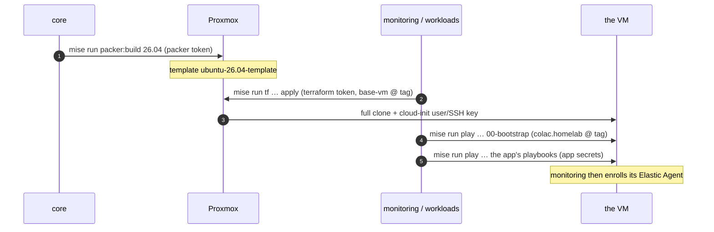
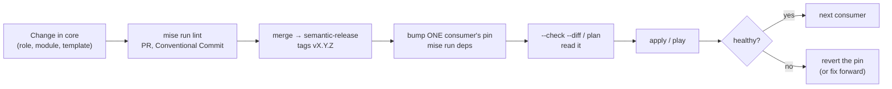
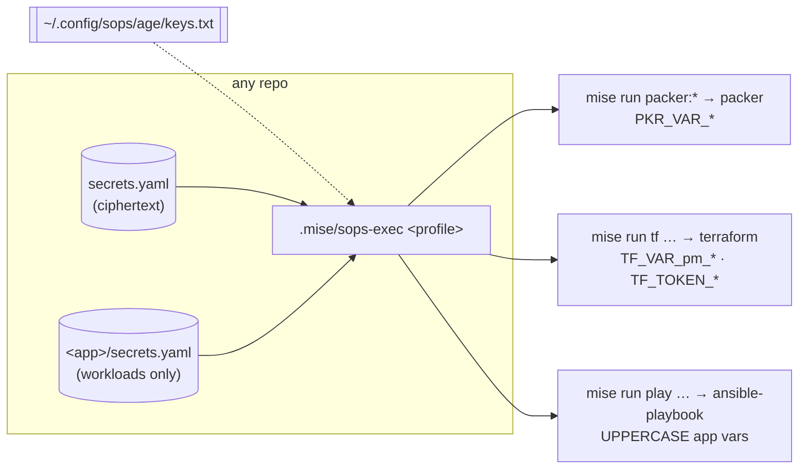

# Homelab architecture

How the homelab is split into three repos, what each one publishes and
consumes, and how a change moves through them. Each repo's own README covers
its internals; this is the page that ties them together.

## The three layers

| Layer | Repo | Owns | Changes |
|---|---|---|---|
| **core** | [homelab-proxmox](https://github.com/colac/homelab-proxmox) (this) | Packer templates, the `base-vm` Terraform module, the `colac.homelab` Ansible collection (`common`, `docker_data`, `agent_access`, `update`), **DNS** (Pi-hole, `dns/`) and the Raspberry Pi's **notification services** next to it (Tailscale, the private ntfy, `dns/NTFY.md`), the **Proxmox host's** identities and backup (`proxmox/`), **TrueNAS** (declared through its API, `TrueNAS/`), homelab-wide docs | Rarely; everything else depends on it |
| **monitoring** | [homelab-proxmox-monitoring](https://github.com/colac/homelab-proxmox-monitoring) | The monitoring VM: single-node Elasticsearch, Kibana, Fleet Server, exporters — and Elastic Agent enrollment on **every** host | Medium |
| **workloads** | [homelab-proxmox-workloads](https://github.com/colac/homelab-proxmox-workloads) | The apps, one folder each: Nextcloud (live), k3s (VM only) | Often |

The split follows blast radius and ownership, not technology:

- **A change can only break its own layer.** A Caddy bump cannot touch
  Elasticsearch, and an Elasticsearch upgrade cannot touch Nextcloud — they
  are different repos, workspaces, secrets and release tags.
- **Each layer holds only the credentials it uses.** Core cannot clone a VM;
  workloads cannot read the Elastic passwords; monitoring cannot read the
  Nextcloud users. Inside each repo, Terraform and Ansible get different
  subsets again (see [Secrets](#secrets-least-privilege-per-command)).
- **Each layer is a small, self-contained context.** A person — or an AI
  agent — working on Nextcloud loads one `AGENTS.md`, one runbook and one
  secrets file, not the history of the Elastic port.
- **Observability is separate from what it observes.** The thing you use to
  see a failure should not share a release, or a failure mode, with it.

## Contracts between the layers

Everything that crosses a repo boundary is explicit, versioned, and written
down here. Nothing else may.

| Contract | Producer → consumer | Form | Changing it safely |
|---|---|---|---|
| VM templates | core → all VMs | Proxmox template **name** (`template_name`) | Build the new one alongside (new `vm_id`), move consumers one at a time, delete the old one last |
| ES OS prerequisites | core → monitoring | Baked into the template: `vm.max_map_count ≥ 262144`, memlock/nofile, `/opt/elastic` | Monitoring's `elastic_preflight` fails loudly if a template lacks them |
| Elastic Agent package | core → every VM | Pre-installed by Packer, disabled; version tracks monitoring's `stack_version` | Drift is tolerated: `elastic_agent` reinstalls the right version |
| `base-vm` module | core → every Terraform project | `git::https://github.com/colac/homelab-proxmox.git//terraform/modules/base-vm?ref=vX.Y.Z` | Release a tag; bump one project's `ref`, `init -upgrade`, read the plan |
| `colac.homelab` collection | core → every Ansible tree | `requirements.yml`: `…homelab-proxmox.git#/ansible/`, `version: vX.Y.Z` | Release a tag; bump one consumer; `00-bootstrap.yml --check --diff` |
| Agent targets | core, workloads → monitoring | Host + address (+ connection user) in monitoring's `ansible/inventory/hosts.yml` (group `agents`): Nextcloud (workloads), `pihole-ct` (core) | Add/remove the entry; run `20` and `50` with `--limit` |
| Nextcloud metrics | workloads → monitoring | `nextcloud_serverinfo_token`, minted on the VM, stored in monitoring's `secrets.yaml` | Re-mint, update monitoring's secret, re-run `45-exporters.yml` |
| Private DNS names | each layer → core | A records (`nextcloud.<zone>`, `kibana.<zone>`, `pve.<zone>`, `truenas.<zone>`) in `pihole_local_records`, `dns/ansible/inventory/group_vars/pihole.yml` | A PR to core, then `mise run dns:play playbooks/10-pihole.yml` |
| TrueNAS metrics | core → monitoring | `truenas_reporting_exporters` in core's `TrueNAS/ansible/inventory/group_vars/truenas.yml`: Graphite to the monitoring VM's `:9109`, prefix `truenas`, namespace = monitoring's `exporters_truenas_instance` | Change both together; core's `truenas:play playbooks/site.yml`, then monitoring's `99-healthcheck.yml` |
| Update procedure | core → monitoring, workloads | `colac.homelab.update` (playbook + `update` role). Each repo declares `update_targets`, `update_components`, `update_checks`, and the Proxmox node in `ansible/update/proxmox.yml` (snapshots, as root) — [UPDATES.md](UPDATES.md) | Release core, bump the pin, `mise run update` (report only) in each consumer |
| Guest ownership | monitoring, workloads → core | Guest names in `update_guests_elsewhere` (`updates/inventory/group_vars/all.yml`); any other guest is UNTRACKED in core's report | Add or remove the name in the same change that adds or removes the VM |
| Toolchain pins | core → all | Same versions in every `mise.toml` (Terraform 1.15.7, ansible-core 2.17.14, …) | Bump in core first, then the others |
| AI agent account | core → every Linux host; monitoring's runner and `hostctl.py` | `colac.homelab.agent_access`: user `homelab-agent`, keys from `~/.config/homelab-agent/ssh/` on the controller, the dispatcher's verbs, `policy.json`; per-host restart lists in each repo's inventory | Add verbs in core (released), bump the pins; lists change per repo |
| Private ntfy | core (`dns/`, group `ntfy`) → monitoring | Topics `homelab-alerts`, `homelab-agent`, `homelab-control`; on the Pi, ntfy at `127.0.0.1:2586`, `/etc/ntfy/clients/{notifier,actions}.token`, `/etc/ntfy/base-url`; for the runner on the laptop, `ntfy_runner_token` and `ntfy_actions_token` in `dns/secrets.yaml`, and the Pi as `pihole-pi` on the tailnet, port 8443 ([dns/NTFY.md](../dns/NTFY.md)) | Change both repos together; `mise run dns:play:ntfy`, then monitoring's notifier play and `mise run agent install` |

## Runtime view

Every machine, the containers and services on each one, and how they talk to
each other: the services you use, DNS, storage, certificates, metrics and
logs, alerts, and the AI agent. The repo that owns each machine is in
brackets. Status as of 2026-11-20:

- **Solid lines and boxes are live.**
- **Dashed boxes and dotted lines are written in the repos but not applied
  yet:** the private ntfy, the doorbell, the alert notifier and the AI
  agent's access. The steps are in monitoring's `docs/ai-ops/deployment.md`.
- **The k3s VM is not deployed;** workloads keeps its Terraform recipe.

```mermaid
flowchart TB
  subgraph ext["Internet: outbound only, nothing is exposed"]
    direction LR
    cf["Cloudflare DNS<br/>ACME DNS-01 TXT records"]
    up["DNS upstreams<br/>1.1.1.1 · 9.9.9.9"]
    tfc["Terraform Cloud<br/>state"]
    ntfysh["ntfy.sh<br/>doorbell topic only"]
    hc["healthchecks.io<br/>notifier heartbeat"]
    anth["Anthropic<br/>Claude Pro plan"]
  end

  subgraph lan["LAN 192.168.1.0/24"]
    router["Router .1<br/>DHCP: DNS server 1 = .153"]

    subgraph pi["Raspberry Pi: pihole-pi .53 (core)"]
      ph1["Pi-hole<br/>primary DNS"]
      ntfy["ntfy :2586<br/>tailscale serve :8443"]
      bell["ntfy-doorbell"]
      notif["alert notifier<br/>(monitoring)"]
      ag1["Elastic Agent"]
    end

    subgraph pve["Proxmox VE: pve .169, API :8006 (core)"]
      tpl["templates 9000 · 9001"]
      ct["LXC pihole-ct .153<br/>Pi-hole, failover DNS<br/>Elastic Agent"]

      subgraph ncvm["VM nextcloud .43 (workloads): Docker"]
        caddy["nextcloud-caddy :443"]
        aio["Nextcloud AIO<br/>apache · nextcloud · database · redis<br/>run by the mastercontainer"]
        tsnc["tailscaled<br/>subnet router"]
        ag2["Elastic Agent"]
      end

      subgraph monvm["VM monitoring .87 (monitoring): Docker"]
        es[("elasticsearch :9200")]
        kb["kibana :443<br/>alert rules"]
        fs["fleet-server :8220"]
        exp["exporter-graphite :9109<br/>exporter-nextcloud<br/>exporter-pve (off)"]
        ag3["Elastic Agent"]
      end
    end

    nas[("TrueNAS (core)<br/>ZFS mirror · SMB shares<br/>Graphite reporting")]
  end

  subgraph you["Your devices"]
    direction LR
    phone(["Phone<br/>ntfy · Nextcloud · Tailscale"])
    subgraph laptop["Laptop: the controller, on the tailnet"]
      iac["mise · Packer · Terraform · Ansible<br/>deploy key · age key"]
      claude["Claude Code: interactive + runner<br/>obs.py · hostctl.py"]
    end
  end

  %% Name resolution
  router -. "hands out" .-> ct
  ct & ph1 -- "upstream" --> up
  tsnc -- "split DNS for &lt;zone&gt;" --> ct

  %% Using the services
  phone -- "tailnet: subnet route" --> tsnc
  tsnc --> caddy
  caddy --> aio
  aio -- "SMB external storage" --> nas
  laptop -- "https://kibana.&lt;zone&gt;" --> kb
  caddy & kb & nas -- "DNS-01 certificates" --> cf

  %% Building and configuring (the human)
  iac -- "API tokens · SSH plays" --> lan
  iac -- "state" --> tfc

  %% Metrics and logs
  ag1 & ag2 & ct -- "Fleet :8220 · data :9200" --> monvm
  fs & kb --> es
  ag3 -- "scrape" --> exp
  nas -- "Graphite :9109" --> exp
  exp -- "serverinfo API" --> caddy

  %% Alerts to the phone and to Claude
  notif -. "active alerts :9200" .-> es
  notif -. "publish" .-> ntfy
  notif -. "heartbeat" .-> hc
  ntfy -. "alerts · reports, tailnet" .-> phone
  phone -. "Investigate button" .-> ntfy
  bell -. "watches the topics" .-> ntfy
  bell -. "only when the phone is off the tailnet" .-> ntfysh
  ntfysh -. "push" .-> phone
  claude -. "reads alerts, posts reports" .-> ntfy
  claude -. "obs.py: read-only API key" .-> es
  claude -. "hostctl: homelab-agent, fixed verbs" .-> pi & ct & ncvm & monvm
  claude -. "homelab-agent@pve: read" .-> pve
  claude -- "claude -p" --> anth

  classDef pending stroke-dasharray: 5 5
  class ntfy,bell,notif pending
```

| Flow | Path | Notes |
|---|---|---|
| DNS | Every device and host → Pi-hole → upstreams | The router hands out the container (`.153`) today; the Pi becomes server 1 at the router switch-over ([DNS](#dns)) |
| Using Nextcloud | LAN, or the tailnet through the Nextcloud VM's subnet route → Caddy `:443` → AIO | Split DNS sends `<zone>` lookups from the tailnet to Pi-hole |
| Files | AIO → TrueNAS over SMB | App data lives on the NAS; VM disks hold rebuildable state and Docker volumes |
| Certificates | Caddy, Kibana and TrueNAS → Cloudflare DNS-01 | Real Let's Encrypt certificates for names only Pi-hole resolves |
| Metrics, logs | Elastic Agent on each host → Fleet Server `:8220` (policy) and Elasticsearch `:9200` (data); TrueNAS → Graphite `:9109`; the Nextcloud exporter → the serverinfo API through Caddy | The Proxmox node has no agent yet (monitoring's TODO) |
| Alerts | Kibana rules → Elasticsearch → the notifier on the Pi → ntfy → the phone and Claude | The doorbell rings through public ntfy.sh with fixed text, only when the phone is off the tailnet |
| AI agent | Claude on the laptop → ntfy, Elasticsearch (read-only key), every Linux host as `homelab-agent` (forced command), Proxmox as `homelab-agent@pve` | No AI access to TrueNAS. Identities and limits: monitoring's `docs/ai-ops/architecture.md` |
| Building | The laptop → the Proxmox API, SSH to each host, the TrueNAS API; Terraform state in Terraform Cloud | Only the human runs these |

- **Nothing is exposed to the internet.** Every connection out of the LAN is
  outbound: Cloudflare only answers ACME DNS-01 challenges, ntfy.sh carries
  only the doorbell's fixed text, and the private ntfy is reachable only on
  the tailnet (`tailscale serve`, never Funnel).
- **Off-LAN reach is Tailscale:** the Nextcloud VM advertises the LAN as a
  subnet route, and split-DNS sends the zone's lookups to Pi-hole
  (`192.168.1.153`). The phone reaches ntfy on the Pi at `:8443` over the
  tailnet.
- **Data lives on TrueNAS**, mounted by apps over SMB, never on a VM disk.
  VM disks hold only rebuildable state and named Docker volumes on a separate
  data disk.

## How a VM comes to exist

The same three stages for every VM, spread over two repos.

| Stage | Owns | Re-run when |
|---|---|---|
| **Packer** (core) | The golden image: OS, hardening, Docker, Tailscale, the Elastic Agent package, the Elasticsearch OS prerequisites | The base OS or baked-in tooling changes (rare) |
| **Terraform** (monitoring, workloads) | VM existence and shape: CPU/RAM/disks, network, cloud-init user | A VM is resized, added or destroyed |
| **Ansible** (monitoring, workloads) | Everything running inside the VM | Any app/config change (often — it is idempotent) |

Cloud-init is used **only** to create the login user and inject the SSH key.
App configuration through Proxmox's cloud-init hung or timed out on first
boot, runs once, and fails silently; Ansible re-runs in seconds and fails
loudly.

## Rolling out a change to a shared piece

One consumer at a time, each step reversible by moving a pin back. The
exception is Elasticsearch data, which upgrades in place and cannot be
downgraded — that is a monitoring-repo concern, documented in its runbook.

## Secrets: least privilege per command

Every repo uses the same scheme: SOPS + age files committed as ciphertext,
decrypted by `.mise/sops-exec` for **one command**, which exports only what
that command's tool reads. Nothing is ever exported into the shell — so
neither a human's terminal nor an AI agent working in the repo holds a
credential between commands.

Which file and profile each repo uses, what each profile exports, and how
every credential is issued and rotated: [CREDENTIALS.md](CREDENTIALS.md).
The next step toward least privilege, one Terraform token per repo, is in
each repo's TODO. The AI agent's identities are in monitoring's
`docs/ai-ops/architecture.md`.

## Tooling

The same in every repo — mise for tools and entry points, Conventional
Commits and semantic-release for versions, one `AGENTS.md` per repo (plus one
per app in workloads) for AI agents. See [DEVELOPMENT.md](DEVELOPMENT.md).

## DNS

Pi-hole is the LAN's resolver and holds the private A records every
service depends on — including `pve.<zone>`, which Packer and Terraform need
to reach the Proxmox API with TLS verification on. It is a **platform
service in core** (`dns/`), designed as two hosts with one configuration:

| Resolver | Address | Role | Status |
|---|---|---|---|
| LXC container `pihole-ct` | `192.168.1.153` | failover; created by Terraform | **live** since 2026-10-07; the one the router and Tailscale hand out today |
| Raspberry Pi `pihole-pi` | `192.168.1.53` | primary; physical, so DNS survives a Proxmox outage | **live** since 2026-11-18; the router and Tailscale switch-over is pending |

The same Ansible role configures both through Pi-hole's own `FTLCONF_*`
settings, which the web UI shows as read-only, so either can answer any query.
The record list is code, and another repo's service gets its name by a PR to
it. Runbook, including a diagram of how a query and a config change flow:
[dns/README.md](../dns/README.md).

Until the router and Tailscale point at the Pi, DNS shares the hypervisor's
fate: if Proxmox is down, so is name resolution — and with it `pve.<zone>`,
the name Terraform needs to fix anything. The runbook's break-glass section
covers that. Both resolvers already send their logs and metrics to monitoring.
CoreDNS as an authoritative zone with transfers to a
secondary is the step after that — worth it once k3s wants wildcard records
or the record list grows, not before.
